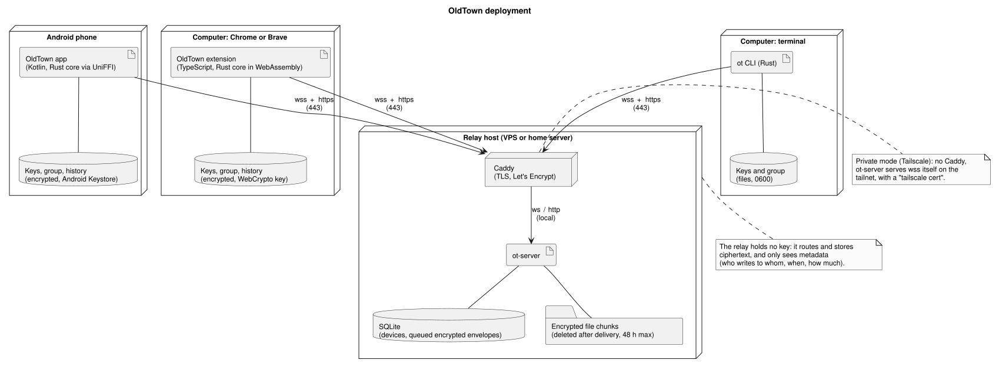
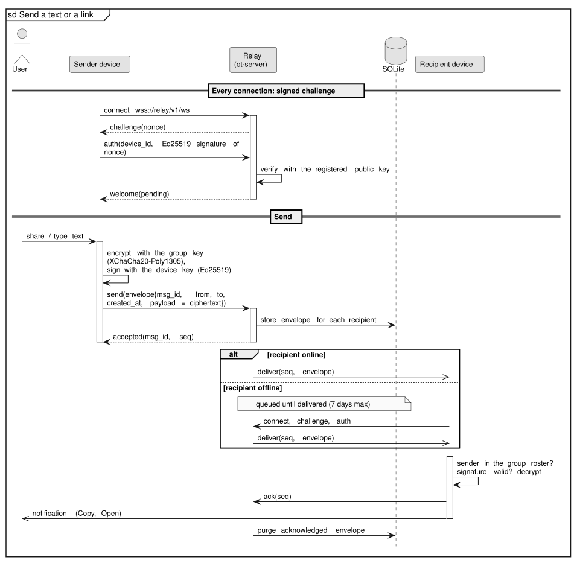
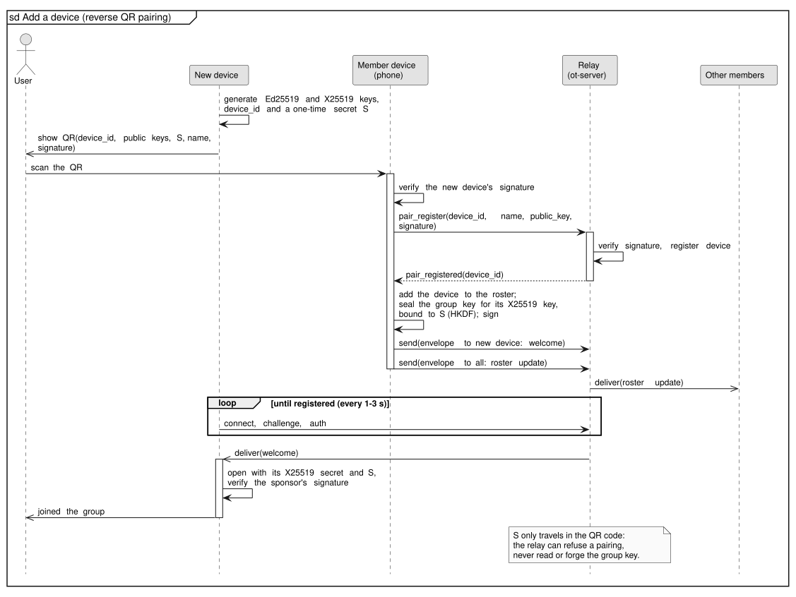
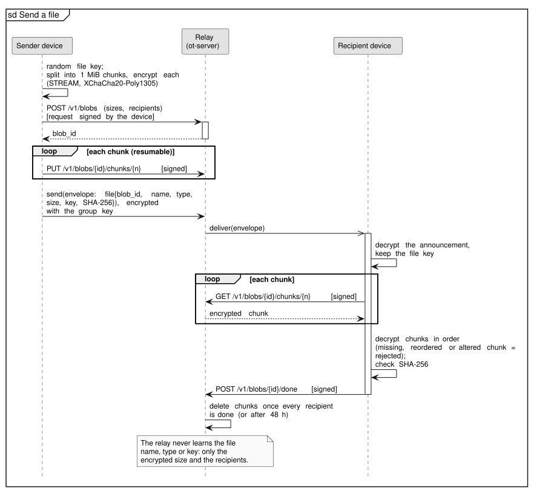

# OldTown

Send texts, links and files between your own devices (Android phone,
Chromium-based browser on any computer, a terminal) through a relay you host
yourself. Everything is end-to-end encrypted under a key that only your
devices hold: the relay stores and forwards ciphertext and never sees the
content.

Think Pushbullet, self-hosted, without an account and without trusting the
server.

> **Status.** A personal project, used daily, published as is under the MIT
> license, without warranty. The apps' interface is in French for now.

**Contents:** [Choose how devices reach the relay](#choose-how-devices-reach-the-relay) ·
[Install](#install) · [Everyday use](#everyday-use) ·
[How it works](#how-it-works) · [Repository](#repository) ·
[Contributing](#contributing)

## Choose how devices reach the relay

The same relay (`ot-server`) works in two ways; the relay URL is a setting
of every client, so you can switch later.

| Mode | What you need | VPN on the clients |
| --- | --- | --- |
| **Public**, on a VPS or a home server | A domain name pointing to the machine, ports 80 and 443 reachable (VPS firewall, or port forwarding on your router; not behind a CGNAT). [Caddy](https://caddyserver.com) gets the TLS certificate. | No: works on a work computer where a VPN is not an option |
| **Private**, with [Tailscale](https://tailscale.com) | Tailscale on the relay and on every device, MagicDNS and HTTPS certificates enabled | Yes |

Setting up a tailnet, a domain or a router is out of scope here.

## Install

Order: the relay, then a first device (the command line), which creates the
group; every other device joins by scanning a QR code.

### 1. The relay

**Public mode (Docker).** On the machine the domain points to:

```sh
git clone https://github.com/Anox-Leo/OldTown && cd OldTown
echo "OT_DOMAIN=relay.example.org" > deploy/docker/.env
docker compose -f deploy/docker/compose.yaml up -d --build
alias ots='docker compose -f deploy/docker/compose.yaml exec relay ot-server'
curl https://relay.example.org/healthz      # ok
```

Clients will use `wss://relay.example.org`. Metrics are only served
locally: `curl http://127.0.0.1:7879/metrics`. To update: `git pull`, then
the same `up -d --build`.

<details>
<summary><b>Public mode without Docker (systemd + Caddy)</b></summary>

Install the relay as in the private mode below (step 1 only: it listens on
`127.0.0.1:7878` by default), install
[Caddy](https://caddyserver.com/docs/install), then:

```sh
sudo install -m 0644 deploy/Caddyfile /etc/caddy/Caddyfile
sudo systemctl edit caddy        # [Service] Environment=OT_DOMAIN=relay.example.org
sudo systemctl edit ot-server    # [Service] Environment=OT_TRUSTED_PROXY=127.0.0.1
sudo systemctl enable --now ot-server.service ot-backup.timer
sudo systemctl restart ot-server caddy
alias ots='sudo -u ot-relay OT_DB=/var/lib/ot-relay/ot.db /usr/local/bin/ot-server'
```

`OT_TRUSTED_PROXY` lets the relay see each client's real IP behind Caddy,
which its rate limits depend on.

</details>

<details>
<summary><b>Private mode (Tailscale, Ubuntu with systemd)</b></summary>

Needs [Rust](https://rustup.rs) 1.88 or later and `build-essential`.

```sh
# 1. Build and install, with a dedicated system user
sudo apt install build-essential sqlite3 jq
sudo useradd --system --home /var/lib/ot-relay --shell /usr/sbin/nologin ot-relay
cargo build --release --locked -p ot-server
sudo install -m 0755 target/release/ot-server /usr/local/bin/
sudo install -D -m 0755 deploy/ot-backup.sh /usr/local/lib/oldtown/ot-backup.sh
sudo install -m 0644 deploy/ot-server.service deploy/ot-backup.service \
  deploy/ot-backup.timer deploy/ot-tls-renew.service deploy/ot-tls-renew.timer /etc/systemd/system/
sudo systemctl daemon-reload

# 2. TLS certificate from Tailscale, renewed daily
sudo install -d /etc/oldtown
echo "OT_TLS_DOMAIN=$(tailscale status --json | jq -r '.Self.DNSName | rtrimstr(".")')" \
  | sudo tee /etc/oldtown/tls.env
sudo systemctl start ot-tls-renew.service
sudo systemctl enable --now ot-tls-renew.timer

# 3. Listen on the Tailscale IP, with the certificate
sudo systemctl edit ot-server
#   [Service]
#   Environment=OT_LISTEN=<tailscale ip>:7878
#   Environment=OT_TLS_CERT=/var/lib/ot-relay/tls/relais.crt
#   Environment=OT_TLS_KEY=/var/lib/ot-relay/tls/relais.key
sudo systemctl enable --now ot-server.service ot-backup.timer
alias ots='sudo -u ot-relay OT_DB=/var/lib/ot-relay/ot.db /usr/local/bin/ot-server'
```

Clients will use `wss://<machine>.<tailnet>.ts.net:7878`.

</details>

Relay settings (environment variables, all optional): `OT_TTL` (unread
messages kept `7d`), `OT_MAX_FILE_SIZE` (`2G`), `OT_BLOB_QUOTA` (disk space
for files in transit, `20G`), `OT_BLOB_TTL` (`48h`); see
`ot-server serve --help`.

### 2. First device: the command line

```sh
cargo install --locked --git https://github.com/Anox-Leo/OldTown ot-cli   # installs `ot`
ot init --server wss://relay.example.org --name laptop                    # prints a public key
ots device add laptop <public key>                                         # on the relay
ot init --device-id <dev_… printed above>
ot group init                                                              # creates the group
```

Prebuilt `ot` binaries for macOS, Windows and Linux are also attached to
each CI run on `main` (*Actions* tab, kept 14 days).

### 3. Android phone

Android 13 or later. Build the APK (JDK 21, Android SDK with NDK
`29.0.14206865`, Rust):

```sh
rustup target add aarch64-linux-android x86_64-linux-android
cargo install --locked cargo-ndk
cd apps/android && ./gradlew assembleDebug
adb install app/build/outputs/apk/debug/app-debug.apk
```

On a group member, run `ot pair new --qr`; in the app, pick a name and scan
the QR code (*Scanner le QR*). Accept notifications and the battery
optimization exemption: the app keeps a connection to the relay to receive
messages.

### 4. Chrome or Brave extension

Build it (Node 24, Rust):

```sh
rustup target add wasm32-unknown-unknown
cargo install --locked wasm-bindgen-cli --version 0.2.129
cd apps/extension && npm ci && npm run build      # output: dist/extension
```

Open `chrome://extensions` (or `brave://extensions`), enable *Developer
mode*, *Load unpacked*, pick `dist/extension`. In the popup, enter the relay
URL and a name, then *Afficher un QR à scanner* (show a QR code); on the
phone, *Groupe* → *Ajouter un appareil* (group → add a device) and scan it.

### 5. More computers with the command line

```sh
ot pair join --qr --server wss://relay.example.org --name desktop
```

Scan the QR code shown in the terminal from the phone, as above.

## Everyday use

- **Android**: *Share* from any app to OldTown (texts, links, photos,
  files), or the conversation screen; received items come as notifications
  with *Copy* and *Open*.
- **Extension**: right-click a page, link, selection or image → *Envoyer à
  OldTown*; `Alt+Shift+S` sends the current tab, `Alt+Shift+V` the
  clipboard; the popup lists conversations per device. Chrome must be
  running to receive; the relay keeps messages for 7 days.
- **Command line**:

  ```sh
  ot send "hello"                        # to all my other devices
  ot send --to phone https://example.org # to one device
  ot send --file video.mp4 --to phone    # a file; run again to resume
  ot listen --download-dir ~/Downloads   # receive, files included
  ot group show                          # members and key fingerprints
  ot group rotate --exclude phone        # lost device: new group key without it
  ots device revoke phone                # then, on the relay: refuse its connections
  ```

## How it works

Each device has its own Ed25519 identity (authentication and signatures) and
X25519 key (to receive the group key). All devices of a group share a
**group key**; messages are encrypted with XChaCha20-Poly1305 under it and
signed by the sender. The relay authenticates devices by a signed challenge,
queues envelopes for offline devices, stores encrypted file chunks, and
deletes everything once delivered. It never holds a key: a compromised relay
can drop or delay messages, not read, alter or forge them.



**Sending a message.** The sender encrypts and signs; the relay stores the
envelope, delivers it when the recipient is online, and purges it once
acknowledged. The recipient accepts it only from a member of its group
roster, with a valid signature.



**Adding a device.** The new device shows a QR code with its public keys and
a one-time secret; a member scans it, has the relay register the device, and
sends it the group key, encrypted for that device and bound to the secret.
The secret never reaches the relay.



**Sending a file.** The file gets its own key and is uploaded in encrypted
1 MiB chunks over signed HTTP requests (resumable); the key travels only
inside the encrypted announcement.



| The relay sees | The relay never sees |
| --- | --- |
| Device names and public keys | Message content, links, file names and types |
| Who sends to whom, when, and sizes (files to the nearest 1 MiB chunk) | Group keys, file keys, private keys |
| IP addresses of connected devices (in memory, for rate limits) | Anything it could use to forge a message from a member |

Removing a lost device is two steps: rotate the group key without it (from
any member: the app, the extension or `ot group rotate --exclude`), then
revoke it on the relay. Threat model and limits: [SECURITY.md](SECURITY.md).

## Repository

| Path | Contents |
| --- | --- |
| `crates/ot-proto` | Frames, envelope, HTTP API; wire format frozen by `tests/golden/` |
| `crates/ot-crypto` | Keys, encryption, signatures, pairing; frozen by `tests/vectors/` |
| `crates/ot-core` | Client core: connection, queue, roster, pairing, files |
| `crates/ot-server` | The relay (axum, SQLite); depends on `ot-proto` only, never on `ot-crypto` |
| `crates/ot-cli` | The `ot` command line |
| `crates/ot-ffi` | UniFFI bridge used by the Android app |
| `crates/ot-wasm` | The client core compiled to WebAssembly for the extension |
| `apps/android` | Android app (Kotlin, Jetpack Compose) |
| `apps/extension` | Chrome extension (Manifest V3, Angular, TypeScript protocol client) |
| `deploy/` | systemd units, Caddyfile, Docker image and compose file |
| `assets/diagrams/` | PlantUML sources of the diagrams above |

The code is the detailed documentation; comments and the per-component
`CLAUDE.md` files (contributor notes, in French) explain the choices.

## Contributing

Issues and pull requests are welcome, in particular:

- an **iOS app** (UniFFI also generates Swift bindings for `crates/ot-ffi`);
- **desktop apps** (macOS, Windows, Linux) on top of `crates/ot-core`;
- an **English interface** for the Android app and the extension.

Before a pull request:

```sh
cargo fmt --all
cargo clippy --workspace --all-targets -- -D warnings
cargo test --workspace
cargo deny check
```

plus `./gradlew lint test assembleDebug` in `apps/android` and
`npm run lint && npm test` in `apps/extension` when you touch them. A change
of the wire or encrypted format must update the golden files or test
vectors on purpose. Diagrams are rendered with
`docker run --rm -v "$PWD:/data" -w /data plantuml/plantuml -tsvg *.puml`
in `assets/diagrams/`.

Security issues: please report them privately, see [SECURITY.md](SECURITY.md).

## License

[MIT](LICENSE)
